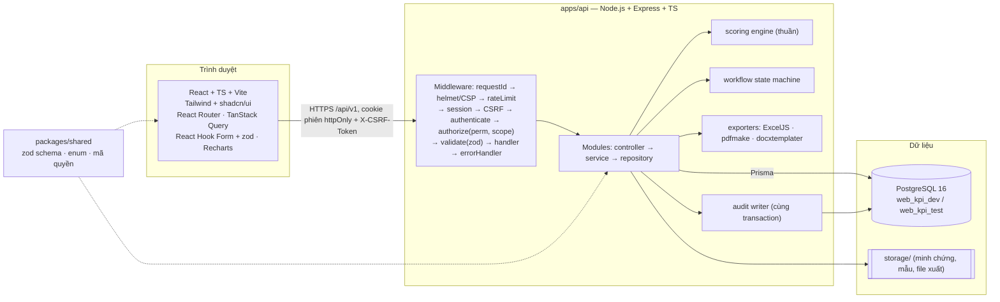

# Kiến trúc và cây thư mục

> Tài liệu thiết kế chuẩn (GĐ1–2, đã duyệt). Mọi thay đổi kiến trúc phải cập nhật tài liệu trước khi sửa code — xem CLAUDE.md.

## Cây thư mục monorepo

```
Web_KPI/
├── CLAUDE.md                          # quy tắc làm việc + kiến trúc (chuẩn cho Claude Code)
├── README.md                          # giới thiệu, cài đặt nhanh
├── package.json                       # npm workspaces: apps/*, packages/*; script chung
├── package-lock.json
├── tsconfig.base.json                 # TS strict dùng chung
├── eslint.config.js  .prettierrc  .editorconfig
├── .gitignore  .gitattributes  .env.example
├── docker-compose.yml                 # postgres:16 (+ healthcheck, volume pgdata); profile "test" cho DB test
├── docker/
│   └── postgres/init/01-create-test-db.sql   # tạo web_kpi_test
├── docs/
│   ├── 00-tong-quan.md                # mục lục, cách đọc tài liệu
│   ├── 01-moi-truong.md               # kiểm tra môi trường, cài WSL2 + Docker Desktop
│   ├── 02-kien-truc.md                # §2
│   ├── 03-database.md                 # §3 (ERD Mermaid + từ điển dữ liệu)
│   ├── 04-api.md                      # §6
│   ├── 05-phan-quyen.md               # §4
│   ├── 06-quy-trinh-trang-thai.md     # §5
│   ├── 07-tieu-chi-va-tinh-diem.md    # §7
│   ├── 08-can-cu-nghiep-vu.md         # trích yếu văn bản, số trang
│   ├── 09-cau-hoi-mo.md               # §8
│   ├── 10-rui-ro-ky-thuat.md          # §9
│   ├── 11-lo-trinh.md                 # §10
│   ├── adr/                           # Architecture Decision Records (0001-monorepo.md, ...)
│   └── references/                    # bản gốc PDF/XLSX — gitignore; chỉ commit README.md
├── packages/
│   └── shared/
│       ├── package.json
│       └── src/
│           ├── index.ts
│           ├── enums.ts               # trạng thái, loại kỳ, vai trò...
│           ├── permissions.ts         # danh mục mã quyền + vai trò mặc định
│           ├── rule-config.schema.ts  # zod schema cấu hình quy tắc tính điểm
│           ├── schemas/               # zod DTO dùng chung FE/BE (employee, task, evaluation...)
│           └── format.ts              # định dạng số/ngày VN
├── apps/
│   ├── api/
│   │   ├── package.json  tsconfig.json  vitest.config.ts
│   │   ├── prisma/
│   │   │   ├── schema.prisma
│   │   │   ├── migrations/            # sinh bởi prisma migrate (+ SQL thủ công: trigger audit, partial index)
│   │   │   └── seed/
│   │   │       ├── index.ts           # chỉ chạy khi SEED_DEMO=true
│   │   │       ├── data/              # org-structure.json (tên giả), work-catalog.json, rule-sets.json
│   │   │       └── pseudonymize.ts
│   │   ├── scripts/
│   │   │   ├── create-admin.ts        # tạo Super Admin qua dòng lệnh (không có mật khẩu mặc định)
│   │   │   ├── backup.ps1  restore.ps1
│   │   │   └── import-catalog.ts      # nạp danh mục SP/CV từ xlsx
│   │   ├── src/
│   │   │   ├── server.ts              # khởi động HTTP
│   │   │   ├── app.ts                 # tạo Express app (dùng trong test)
│   │   │   ├── config/env.ts          # đọc + validate biến môi trường (zod)
│   │   │   ├── lib/                   # prisma.ts, logger.ts (pino, redact), errors.ts, decimal.ts, storage.ts, hash.ts
│   │   │   ├── middlewares/           # request-id, security-headers, rate-limit, session, csrf,
│   │   │   │                          # authenticate, authorize, validate, error-handler, audit-context
│   │   │   ├── authz/                 # scope-resolver.ts, scope-where.ts (lọc dữ liệu theo phạm vi)
│   │   │   ├── scoring/               # engine thuần (không DB): engine.ts, kpi.ts, rating.ts,
│   │   │   │                          # aggregate.ts, explain.ts, *.test.ts (có test ví dụ HD05)
│   │   │   ├── workflow/              # state-machine.ts, approval-resolver.ts, *.test.ts
│   │   │   ├── exporters/             # excel.ts (ExcelJS + chống formula injection), pdf.ts (pdfmake), docx.ts
│   │   │   └── modules/
│   │   │       ├── auth/  users/  roles/  org-units/  positions/  job-positions/  employees/  imports/
│   │   │       ├── periods/  rule-sets/  catalogs/  criteria/  objectives/  tasks/  evidence/
│   │   │       ├── evaluations/  approvals/  dashboard/  reports/  exports/  templates/  drafts/
│   │   │       ├── audit/  notifications/  settings/  health/
│   │   │       └── <module>/{routes.ts, controller.ts, service.ts, repository.ts, dto.ts, *.test.ts}
│   │   └── tests/
│   │       ├── helpers/ (db-reset chỉ cho web_kpi_test, factories, login helper)
│   │       ├── integration/           # Supertest theo module
│   │       └── security/              # truy cập chéo, CSRF, rate limit, upload độc hại
│   └── web/
│       ├── package.json  tsconfig.json  vite.config.ts  tailwind.config.ts  components.json (shadcn)
│       ├── index.html
│       ├── public/fonts/              # font tiếng Việt cho giao diện
│       ├── src/
│       │   ├── main.tsx
│       │   ├── app/                   # router.tsx (định nghĩa route + guard quyền), providers.tsx, layout/
│       │   │                          # (Sidebar, Header, Breadcrumb, PageContainer)
│       │   ├── components/ui/         # shadcn/ui (button, table, dialog, form...)
│       │   ├── components/common/     # DataTable, FilterBar, EmptyState, ErrorState, ConfirmDialog, StatusBadge
│       │   ├── features/              # mỗi nghiệp vụ: api.ts (TanStack Query), components/, pages/, hooks/
│       │   │   ├── auth/ dashboard/ org/ employees/ catalogs/ criteria/ periods/ objectives/
│       │   │   ├── tasks/ evaluations/ approvals/ reports/ drafts/ audit/ admin/
│       │   ├── lib/                   # api-client.ts (fetch + CSRF + lỗi chuẩn), permissions.ts, format.ts
│       │   └── styles/globals.css
│       └── e2e/                       # Playwright: auth.spec, task-flow.spec, evaluation-flow.spec, export.spec
└── storage/                           # gitignore — minh chứng, mẫu văn bản, file xuất (ngoài web root)
```

## Sơ đồ kiến trúc



**Các điểm then chốt:**

- **Monorepo npm workspaces**. `packages/shared` chứa zod schema dùng chung, nên dữ liệu được validate giống nhau ở FE (form) và BE (middleware).
- **Phân tầng backend:** route chỉ khai báo quyền + schema. Service chứa nghiệp vụ và transaction. Repository là nơi duy nhất gọi Prisma và **luôn nhận `scopeWhere`**, để tránh rò dữ liệu ngoài phạm vi (kể cả trong dashboard/aggregate).
- **Engine tính điểm và state machine là hàm thuần**, test độc lập, không phụ thuộc DB.
- **Phiên đăng nhập lưu phía server** (bảng `sessions`) để thu hồi ngay được:
  - Cookie `sid` là chuỗi ngẫu nhiên 256 bit. DB chỉ lưu SHA-256 của chuỗi này.
  - Cookie có `httpOnly`, `SameSite=Strict`, và `Secure` khi chạy prod.
  - Có idle timeout và absolute timeout cấu hình được.
  - Đổi session id sau khi đăng nhập.
  - CSRF theo kiểu synchronizer token gắn với phiên, gửi qua header `X-CSRF-Token`.
  - Mật khẩu băm bằng argon2id (`@node-rs/argon2`).
- **Thời gian:** DB lưu `timestamptz` UTC; giao diện và báo cáo hiển thị theo `Asia/Ho_Chi_Minh`.
- **Số thập phân:** dùng `Decimal` (Prisma/decimal.js) trong toàn bộ engine. Làm tròn theo cấu hình, chỉ làm tròn ở bước hiển thị/chốt.
- **Dev:** Vite (5173) proxy `/api` sang API (4000); Postgres (5432) chạy trong Docker. **Prod (tham khảo):** reverse proxy (Nginx) làm HTTPS, phục vụ build tĩnh của web và proxy API; DB đặt trong mạng nội bộ.
