# Thiết kế cơ sở dữ liệu (ERD)

> Tài liệu thiết kế chuẩn (GĐ1–2, đã duyệt). Mọi thay đổi kiến trúc phải cập nhật tài liệu trước khi sửa code — xem CLAUDE.md.

## 3.1 Quy ước

- PK `id uuid` (trừ `audit_logs.id bigserial`). FK đặt tên `<bảng>_id`. Tên bảng snake_case (Prisma `@@map`).
- Bảng nghiệp vụ có `created_at`, `updated_at`, `created_by`. Bảng chịu cập nhật đồng thời có `version int` (optimistic lock).
- **Không xóa cứng** dữ liệu đã phát sinh nghiệp vụ: dùng `status = ARCHIVED` / `deleted_at`. Đặt `ON DELETE RESTRICT` cho FK nghiệp vụ; chỉ bảng con thuần túy mới dùng `CASCADE` (ví dụ `role_permissions`).
- Ràng buộc đặc biệt viết bằng SQL trong migration: partial unique index, CHECK, trigger.

## 3.2 Sơ đồ quan hệ

```mermaid
erDiagram
  users ||--o{ user_roles : has
  roles ||--o{ user_roles : granted
  roles ||--o{ role_permissions : has
  permissions ||--o{ role_permissions : in
  user_roles ||--o{ user_role_units : scopes
  organizational_units ||--o{ user_role_units : scoped
  users ||--o{ sessions : opens
  employees |o--o| users : "account of"
  organizational_units ||--o{ organizational_units : parent
  employees ||--o{ employee_assignments : has
  organizational_units ||--o{ employee_assignments : in
  positions ||--o{ employee_assignments : as
  job_positions ||--o{ employee_assignments : vtvl
  employees ||--o{ employee_assignments : "manages (manager_employee_id)"
  employees ||--o{ unit_supervisions : supervises
  organizational_units ||--o{ unit_supervisions : supervised
  evaluation_periods ||--o{ evaluation_periods : parent
  rule_sets ||--o{ rule_set_versions : versions
  work_catalogs ||--o{ work_catalog_versions : versions
  work_catalog_versions ||--o{ work_catalog_items : items
  criteria_sets ||--o{ criteria_set_targets : "applies to"
  criteria_sets ||--o{ criteria_versions : versions
  criteria_versions ||--o{ criteria_items : items
  criteria_items ||--o{ criteria_items : "group/child"
  rule_set_versions ||--o{ criteria_versions : "formula binding"
  work_catalog_versions ||--o{ criteria_versions : "catalog binding"
  evaluation_periods ||--o{ kpi_okr_objectives : in
  kpi_okr_objectives ||--o{ key_results : has
  key_results ||--o{ key_result_checkins : has
  evaluation_periods ||--o{ tasks : in
  work_catalog_items ||--o{ tasks : "typed as"
  criteria_items ||--o{ tasks : "axis"
  key_results ||--o{ tasks : "contributes"
  tasks ||--o{ task_assignees : has
  employees ||--o{ task_assignees : assigned
  tasks ||--o{ task_updates : has
  tasks ||--o{ task_quality_events : has
  tasks ||--o{ evidence_files : has
  task_updates ||--o{ evidence_files : has
  evaluation_periods ||--o{ evaluation_records : in
  criteria_versions ||--o{ evaluation_records : uses
  rule_set_versions ||--o{ evaluation_records : uses
  evaluation_records ||--o{ evaluation_items : has
  criteria_items ||--o{ evaluation_items : scores
  evaluation_records ||--o{ evaluation_calculations : snapshots
  evaluation_records ||--o{ standout_achievements : has
  evaluation_records ||--o{ approval_history : logs
  approval_flows ||--o{ approval_steps : has
  approval_steps ||--o{ approval_history : at
  evaluation_records ||--o{ rating_flags : has
  report_templates ||--o{ generated_documents : renders
  users ||--o{ notifications : receives
  users ||--o{ audit_logs : acts
```

## 3.3 Từ điển dữ liệu (trường chính; PK = khóa chính, FK = khóa ngoại, UQ = duy nhất, IX = chỉ mục)

**A. Danh tính và phân quyền**

| Bảng               | Trường                                                                                                                                                                                           | Khóa/ràng buộc                                                          |
| ------------------ | ------------------------------------------------------------------------------------------------------------------------------------------------------------------------------------------------ | ----------------------------------------------------------------------- |
| `users`            | id, username, password_hash, employee_id, status(ACTIVE/LOCKED/DISABLED), must_change_password, failed_login_count, locked_until, password_changed_at, last_login_at, mfa_secret(null, dự phòng) | PK id; UQ username; UQ employee_id (nullable); FK employee_id→employees |
| `roles`            | id, code(SUPER_ADMIN/AGENCY_LEADER/UNIT_LEADER/EVAL_OFFICER/EMPLOYEE/…), name, is_system                                                                                                         | UQ code                                                                 |
| `permissions`      | id, code (vd `evaluation.approve`), module, description                                                                                                                                          | UQ code                                                                 |
| `role_permissions` | role_id, permission_id                                                                                                                                                                           | PK(role_id, permission_id); CASCADE                                     |
| `user_roles`       | id, user_id, role_id, scope_type(ALL/UNITS/OWN_UNIT/MANAGED/SELF), valid_from, valid_to, granted_by                                                                                              | FK user_id, role_id, granted_by→users; IX(user_id)                      |
| `user_role_units`  | user_role_id, unit_id                                                                                                                                                                            | PK(user_role_id, unit_id) — dùng khi scope=UNITS                        |
| `sessions`         | id, token_hash, user_id, csrf_token_hash, ip, user_agent, created_at, last_seen_at, expires_at, revoked_at                                                                                       | UQ token_hash; IX(user_id); IX(expires_at)                              |
| `login_attempts`   | id, username, ip, success, reason, at                                                                                                                                                            | IX(username, at), IX(ip, at)                                            |

**B. Tổ chức và nhân sự**

| Bảng                                      | Trường                                                                                                                                                                                                   | Khóa/ràng buộc                                                                                            |
| ----------------------------------------- | -------------------------------------------------------------------------------------------------------------------------------------------------------------------------------------------------------- | --------------------------------------------------------------------------------------------------------- |
| `organizational_units`                    | id, code, name, short_name, type(AGENCY/LEADERSHIP_BOARD/DEPARTMENT/OFFICE), parent_id, sort_order, status(ACTIVE/ARCHIVED), effective_from, effective_to                                                | UQ code; FK parent_id→self                                                                                |
| `positions` (chức vụ)                     | id, code, name, level(1–5), is_leadership, kpi_profile(LEADER/STAFF)                                                                                                                                     | UQ code; CHECK level 1–5                                                                                  |
| `job_positions` (VTVL)                    | id, code, name, group(LEADERSHIP/PROFESSIONAL/SHARED_SUPPORT), description, status                                                                                                                       | UQ code                                                                                                   |
| `employees`                               | id, employee_code, full_name, gender(MALE/FEMALE, null), date_of_birth(null), email, phone, party_position, gov_position, union_position, status(WORKING/TRANSFERRED/RETIRED/ARCHIVED), is_demo, version | UQ employee_code; IX(full_name)                                                                           |
| `employee_assignments`                    | id, employee_id, unit_id, position_id, job_position_id, manager_employee_id, is_primary, start_date, end_date, decision_ref, note                                                                        | FK đầy đủ; **partial UQ(employee_id) WHERE is_primary AND end_date IS NULL**; CHECK end_date ≥ start_date |
| `unit_supervisions` (PTB phụ trách phòng) | id, employee_id, unit_id, start_date, end_date                                                                                                                                                           | IX(unit_id)                                                                                               |

Họ tên, ngày sinh và các chức vụ được giữ lại vì Mẫu 5 cần. **Không thu thập** CCCD, địa chỉ hay thông tin sức khỏe.

**C. Kỳ, quy tắc, danh mục, bộ tiêu chí**

| Bảng                    | Trường                                                                                                                                                                                                                                                                                                                                       | Khóa/ràng buộc                                                                                                      |
| ----------------------- | -------------------------------------------------------------------------------------------------------------------------------------------------------------------------------------------------------------------------------------------------------------------------------------------------------------------------------------------- | ------------------------------------------------------------------------------------------------------------------- |
| `evaluation_periods`    | id, code (vd `2026-Q2`, `2026-M07`), type(MONTH/QUARTER/HALF_YEAR/YEAR), year, seq, start_date, end_date, parent_id, status(PLANNING/OPEN/SELF_ASSESSMENT/REVIEW/CLOSED), is_rated, self_deadline, review_deadline, submit_deadline                                                                                                          | UQ code; UQ(type, year, seq)                                                                                        |
| `rule_sets`             | id, code, name, subject_kind(INDIVIDUAL/COLLECTIVE), description                                                                                                                                                                                                                                                                             | UQ code                                                                                                             |
| `rule_set_versions`     | id, rule_set_id, version_no, status(DRAFT/PENDING_CONFIRMATION/CONFIRMED/RETIRED), **config jsonb** (§7.3), legal_basis, source_refs jsonb, effective_from, effective_to, checksum, created_by, confirmed_by, confirmed_at, confirm_note                                                                                                     | UQ(rule_set_id, version_no); **trigger chặn UPDATE config khi CONFIRMED**                                           |
| `work_catalogs`         | id, code, name, owner_unit_id                                                                                                                                                                                                                                                                                                                | UQ code                                                                                                             |
| `work_catalog_versions` | id, catalog_id, version_no, status, standard_points (vd 90), legal_basis, effective_from/to, approved_by/at                                                                                                                                                                                                                                  | UQ(catalog_id, version_no)                                                                                          |
| `work_catalog_items`    | id, catalog_version_id, code (vd `C.006`), group_code(A/B/C/D), name, product, complexity_level, max_hours_text, points, coefficient (lưu = points/standard_points), note                                                                                                                                                                    | UQ(catalog_version_id, code); CHECK points>0                                                                        |
| `criteria_sets`         | id, code, name, target_kind(INDIVIDUAL/COLLECTIVE), description                                                                                                                                                                                                                                                                              | UQ code                                                                                                             |
| `criteria_set_targets`  | criteria_set_id, job_position_id?, position_level?, kpi_profile?, unit_type?                                                                                                                                                                                                                                                                 | xác định bộ tiêu chí áp cho ai                                                                                      |
| `criteria_versions`     | id, criteria_set_id, version_no, status(DRAFT/SUBMITTED/APPROVED/RETIRED), period_types[], general_max, result_max, rule_set_version_id, work_catalog_version_id, effective_from/to, approved_by/at, change_note                                                                                                                             | UQ(criteria_set_id, version_no)                                                                                     |
| `criteria_items`        | id, criteria_version_id, parent_id, kind(GENERAL_GROUP/GENERAL_ITEM/AXIS/AXIS_INDICATOR), code, name, description, max_points, scoring_method(PASS_FAIL/KPI_COMPOSITE/MANUAL_SCORE/QUALITATIVE_3/NOT_APPLICABLE_ALLOWED), measure_unit, data_source, evidence_required, direction(INCREASE/DECREASE/BOOLEAN/QUALITATIVE), is_key, sort_order | UQ(criteria_version_id, code). **Service kiểm tra:** Σ GENERAL_ITEM = general_max; Σ AXIS = result_max; Σ con ≤ cha |

**D. KPI/OKR và nhiệm vụ**

| Bảng                  | Trường                                                                                                                                                                                                                                                                                                                                                                                                                | Khóa/ràng buộc                                                                        |
| --------------------- | --------------------------------------------------------------------------------------------------------------------------------------------------------------------------------------------------------------------------------------------------------------------------------------------------------------------------------------------------------------------------------------------------------------------- | ------------------------------------------------------------------------------------- |
| `kpi_okr_objectives`  | id, period_id, owner_kind(EMPLOYEE/UNIT), owner_employee_id, owner_unit_id, parent_objective_id, criteria_item_id(trục), code, title, description, status, version                                                                                                                                                                                                                                                    | CHECK đúng 1 owner                                                                    |
| `key_results`         | id, objective_id, code, title, kind(KR/KPI), measure_type(NUMBER/PERCENT/BOOLEAN/MILESTONE/QUALITATIVE), direction, measure_unit, baseline, target, actual, data_source, evidence_required, due_date, owner_employee_id, status, version                                                                                                                                                                              |                                                                                       |
| `key_result_checkins` | id, key_result_id, value, note, checked_by, checked_at                                                                                                                                                                                                                                                                                                                                                                | append-only                                                                           |
| `tasks`               | id, code, period_id, unit_id, title, description, source(PLAN/ASSIGNED_BY_SUPERIOR/AD_HOC), catalog_item_id, coefficient_snapshot, criteria_item_id(trục), key_result_id, planned_quantity, priority(LOW/NORMAL/HIGH/URGENT), start_date, due_date, work_status(NOT_STARTED/IN_PROGRESS/COMPLETED/CANCELLED), progress_pct, completed_quantity, completed_at, exceeded_requirement, is_key_task, assigned_by, version | UQ code; IX(period_id, unit_id); IX(due_date). **Quá hạn = trường suy ra**, không lưu |
| `task_assignees`      | task_id, employee_id, role(MAIN/COORDINATOR), credit_share                                                                                                                                                                                                                                                                                                                                                            | PK(task_id, employee_id); **partial UQ(task_id) WHERE role='MAIN'**                   |
| `task_updates`        | id, task_id, author_id, kind(PROGRESS/RESULT/COMMENT/REVIEW_NOTE), completed_quantity_delta, progress_pct, result_text, difficulties, proposals, created_at                                                                                                                                                                                                                                                           | append-only                                                                           |
| `task_quality_events` | id, task_id, kind(REWORK/LATE), occurred_at, reason, recorded_by, exempted, exempt_reason, exempted_by, exempted_at                                                                                                                                                                                                                                                                                                   | dữ liệu nguồn để trừ 25%                                                              |
| `evidence_files`      | id, task_id, task_update_id, evaluation_id, original_name, storage_key, mime_type, size_bytes, sha256, classification_ack(bool, xác nhận không chứa BMNN), uploaded_by, uploaded_at, deleted_at                                                                                                                                                                                                                       | CHECK có ít nhất 1 liên kết                                                           |

**E. Đánh giá, tính điểm, phê duyệt**

| Bảng                                                        | Trường                                                                                                                                                                                                                                                                                                                                                                                                         | Khóa/ràng buộc                                                                                             |
| ----------------------------------------------------------- | -------------------------------------------------------------------------------------------------------------------------------------------------------------------------------------------------------------------------------------------------------------------------------------------------------------------------------------------------------------------------------------------------------------- | ---------------------------------------------------------------------------------------------------------- |
| `evaluation_records`                                        | id, period_id, subject_kind(EMPLOYEE/UNIT), subject_employee_id, subject_unit_id, assignment_snapshot jsonb (phòng/chức vụ/VTVL tại thời điểm), criteria_version_id, rule_set_version_id, approval_flow_id, current_step_no, status (§5), revision_no, self_total, reviewer_total, final_total, self_rating, proposed_rating, final_rating, final_rating_decided_by, external_decision_ref, locked_at, version | **partial UQ(period_id, subject_employee_id) WHERE status<>'CANCELLED' AND is_current**; tương tự cho unit |
| `evaluation_items`                                          | id, evaluation_id, criteria_item_id, self_value, self_note, reviewer_value, reviewer_note, not_applicable, na_reason, kpi_a, kpi_b, kpi_c, kpi_d, d_components jsonb, axis_kpi, axis_points                                                                                                                                                                                                                    | UQ(evaluation_id, criteria_item_id)                                                                        |
| `rating_flags` (điều kiện loại trừ/hạ mức, Điều 11 khoản 4) | id, evaluation_id, code, value, note, evidence_file_id, recorded_by                                                                                                                                                                                                                                                                                                                                            | ví dụ: kỷ luật từ khiển trách, kết luận suy thoái…                                                         |
| `standout_achievements`                                     | id, evaluation_id, content, source, target, result                                                                                                                                                                                                                                                                                                                                                             | Bảng nhiệm vụ nổi trội (HD05) cho đề xuất HTXS                                                             |
| `evaluation_calculations`                                   | id, evaluation_id, kind(TRIAL/SUBMIT/REVIEW/APPROVAL), engine_version, rule_set_version_id, criteria_version_id, inputs jsonb, outputs jsonb, explanation jsonb, warnings jsonb, checksum, created_by, created_at                                                                                                                                                                                              | **APPROVAL là bất biến** (trigger)                                                                         |
| `approval_flows`                                            | id, code, name, subject_kind, applies_to jsonb (kpi_profile, level), is_active, version_no                                                                                                                                                                                                                                                                                                                     |                                                                                                            |
| `approval_steps`                                            | id, flow_id, step_no, name, actor_resolver(DIRECT_MANAGER/UNIT_HEAD/EVAL_OFFICER/SUPERVISING_LEADER/HEAD_OF_AGENCY/EXTERNAL_AUTHORITY), required_permission, can_score, can_return, can_decide_rating, sla_days                                                                                                                                                                                                | UQ(flow_id, step_no)                                                                                       |
| `approval_history`                                          | id, evaluation_id, step_no, action, from_status, to_status, actor_user_id, comment, reason, created_at, ip, request_id                                                                                                                                                                                                                                                                                         | append-only                                                                                                |

**F. Văn bản, hệ thống**

| Bảng                  | Trường                                                                                                                                                                                         | Khóa/ràng buộc                                                                                                         |
| --------------------- | ---------------------------------------------------------------------------------------------------------------------------------------------------------------------------------------------- | ---------------------------------------------------------------------------------------------------------------------- |
| `report_templates`    | id, code, name, doc_kind(REPORT/SUBMISSION/DECISION), storage_key, field_schema jsonb, version_no, status, created_by                                                                          | UQ(code, version_no)                                                                                                   |
| `generated_documents` | id, template_id, period_id, scope_unit_id, data_snapshot jsonb, missing_fields jsonb, status(DRAFT/REVIEWED/APPROVED_FOR_SIGNING/CANCELLED), storage_key, created_by, reviewed_by, approved_by | Watermark "DỰ THẢO" khi chưa APPROVED_FOR_SIGNING                                                                      |
| `audit_logs`          | id bigserial, occurred_at, actor_user_id, actor_ip, request_id, action, entity_type, entity_id, result(SUCCESS/DENIED/FAILURE), changes jsonb (đã che trường nhạy cảm), prev_hash, hash        | **Trigger chặn UPDATE/DELETE**; chuỗi băm để phát hiện sửa; IX(entity_type, entity_id), IX(actor_user_id, occurred_at) |
| `notifications`       | id, user_id, kind, title, body, link, read_at, created_at                                                                                                                                      | IX(user_id, read_at)                                                                                                   |
| `system_settings`     | key, value jsonb, updated_by, updated_at                                                                                                                                                       | PK key                                                                                                                 |
| `import_jobs`         | id, kind(EMPLOYEES/CATALOG/ORG), storage_key, status(UPLOADED/VALIDATED/COMMITTED/FAILED), total_rows, valid_rows, errors jsonb, created_by, committed_at                                      |                                                                                                                        |

## Trạng thái triển khai (GĐ5) và điều chỉnh so với thiết kế

Migration `20261011082211_gd5_kpi_okr_scoring` thêm 15 bảng:

| Nhóm        | Bảng                                                                                      | Ghi chú                                                                                                                                                                                                                                                                                                             |
| ----------- | ----------------------------------------------------------------------------------------- | ------------------------------------------------------------------------------------------------------------------------------------------------------------------------------------------------------------------------------------------------------------------------------------------------------------------- |
| Quy tắc     | `rule_sets`, `rule_set_versions`                                                          | `config` jsonb (schema `rule-config.ts`), `source_refs`, `checksum` sha256; trigger `rule_set_versions_immutable`: bản CONFIRMED/RETIRED không sửa nội dung, chỉ CONFIRMED → RETIRED; chỉ xóa được bản DRAFT                                                                                                        |
| Danh mục    | `work_catalogs`, `work_catalog_versions`, `work_catalog_items`                            | `coefficient` lưu sẵn = điểm/điểm chuẩn; trigger khóa mục khi APPROVED/RETIRED                                                                                                                                                                                                                                      |
| Bộ tiêu chí | `criteria_sets`, `criteria_versions`, `criteria_items`                                    | Đối tượng áp dụng ghi thẳng ở `criteria_sets.kpi_profile` + `job_position_id` (thay cho bảng `criteria_set_targets`); `criteria_items` có `weight`, `scoring_method`, `direction`, `target`, `baseline`, `allow_not_applicable`; trigger: mục chỉ ghi được khi phiên bản DRAFT, phiên bản APPROVED/RETIRED bất biến |
| OKR         | `objectives`, `key_results`, `key_result_checkins`                                        | (tên `objectives` thay cho `kpi_okr_objectives`); CHECK đúng 1 chủ sở hữu; check-in **chỉ ghi thêm** (trigger)                                                                                                                                                                                                      |
| Đánh giá    | `evaluation_records`, `evaluation_items`, `evaluation_calculations`, `evaluation_history` | Xem dưới                                                                                                                                                                                                                                                                                                            |

**Điều chỉnh bảng đánh giá:**

- `evaluation_records`: `self_total/review_total/approved_total`, `self_rating/review_rating/approved_rating`, `rating_override_reason`, `review_flags text[]` (thay cho bảng `rating_flags`), `unit_id` (đơn vị lúc tạo hồ sơ — dùng lọc phạm vi), `kpi_profile`, `revision_no`, `locked_at`, `is_demo`, `version`. UQ(period_id, subject_employee_id): một hồ sơ cho mỗi người mỗi kỳ; điều chỉnh sau phê duyệt tăng `revision_no` thay vì tạo bản ghi mới. Trigger `evaluation_records_lock`: hồ sơ APPROVED chỉ được chuyển sang REOPENED **và** `revision_no + 1`; không xóa được hồ sơ đã có ảnh chụp tính điểm.
- `evaluation_items`: dữ liệu chấm dạng jsonb `self_input`, `review_input` (theo `itemInputSchema`) + ghi chú; trigger chặn ghi khi hồ sơ APPROVED.
- `evaluation_calculations`: `kind` = TRIAL/SELF/REVIEW/APPROVAL (hiện không lưu TRIAL), `revision_no`, `engine_version`, `rule_set_version_id`, `rule_set_checksum`, `criteria_version_id`, `inputs`, `result` (gồm giải thích), `checksum`. **Toàn bộ bảng chỉ ghi thêm** (trigger).
- `evaluation_history` (thay cho `approval_history`): action, from/to status, actor, comment — chỉ ghi thêm.
- Chưa triển khai: `approval_flows/steps` (chuỗi duyệt nhiều bước), `standout_achievements`, `tasks`/`task_*`/`evidence_files` — dữ liệu nhiệm vụ hiện nhập trực tiếp trong phiếu chấm (bảng dòng KPI tổng hợp).

## Giao việc hằng ngày (14/10/2026)

Bảng `daily_tasks` — sổ giao việc theo ngày (docs/06 §5.7). Chỉ để **theo dõi**, không quy đổi thành điểm.

| Trường                                         | Kiểu                        | Ghi chú                                                                    |
| ---------------------------------------------- | --------------------------- | -------------------------------------------------------------------------- |
| `id`                                           | uuid v7                     | PK                                                                         |
| `employee_id`                                  | uuid                        | FK `employees` (RESTRICT) — cán bộ được giao                               |
| `unit_id`                                      | uuid                        | FK `organizational_units` — đơn vị của cán bộ lúc giao (lưu vết)           |
| `work_date`                                    | date                        | Ngày làm việc (bất kỳ ngày nào, kể cả cuối tuần)                           |
| `title`                                        | varchar(500)                | Nội dung công việc                                                         |
| `description`                                  | text?                       | Yêu cầu, sản phẩm cần có                                                   |
| `report_status`                                | enum `DailyReportStatus`    | `PENDING` (chưa báo cáo) / `DONE` (đã xong) / `NOT_DONE` (chưa xong)       |
| `report_note`, `reported_at`                   | text?, timestamptz?         | Báo cáo của cán bộ                                                         |
| `result`                                       | enum `DailyTaskResult`?     | Đánh giá của cấp trên: `COMPLETED` / `NOT_COMPLETED`; null = chưa đánh giá |
| `quality`                                      | enum `DailyTaskQuality`?    | `MEETS` (đạt yêu cầu) / `REWORK` (phải làm lại) — bắt buộc khi `COMPLETED` |
| `timeliness`                                   | enum `DailyTaskTimeliness`? | `ON_TIME` (đúng hạn) / `LATE` (chậm) — bắt buộc khi `COMPLETED`            |
| `eval_comment`, `evaluated_by`, `evaluated_at` | text?, uuid?, timestamptz?  | Nhận xét, người và thời điểm đánh giá                                      |
| `assigned_by`                                  | uuid                        | Người giao (users)                                                         |
| `created_at`, `updated_at`, `version`          |                             | Khóa lạc quan theo `version`                                               |

Chỉ mục: (`employee_id`, `work_date`), (`unit_id`, `work_date`). CHECK (migration SQL): `result` null ⇔ `evaluated_at` null; khi `result = 'COMPLETED'` thì `quality`, `timeliness` khác null; khi `NOT_COMPLETED` thì cả hai null.

## Danh mục sản phẩm/công việc theo vị trí việc làm (15/10/2026)

Bảng `job_position_work_items` — mỗi vị trí việc làm (VTVL) được dùng những sản phẩm/công việc nào trong danh mục (docs/05 "Danh mục theo vị trí việc làm").

| Trường                     | Kiểu               | Ghi chú                                                                                                               |
| -------------------------- | ------------------ | --------------------------------------------------------------------------------------------------------------------- |
| `job_position_id`          | uuid               | FK `job_positions` (CASCADE — bảng con thuần túy)                                                                     |
| `item_code`                | varchar(50)        | Mã sản phẩm/công việc (ví dụ `C.006`) — theo **mã**, không theo id, nên áp dụng cho mọi phiên bản danh mục có cùng mã |
| `created_by`, `created_at` | uuid?, timestamptz | Người phân                                                                                                            |

PK (`job_position_id`, `item_code`). Phân mặc định (seed DEMO):

| Nhóm danh mục (theo tiêu đề nhóm trong file nguồn)                                                              | VTVL được phân mặc định                                                                     |
| --------------------------------------------------------------------------------------------------------------- | ------------------------------------------------------------------------------------------- |
| A — "Nhóm công việc theo VTVL lãnh đạo, quản lý cấp phòng"                                                      | Lãnh đạo, quản lý cấp phòng; Lãnh đạo Ban (*)                                               |
| B — "Nhóm công việc theo VTVL chuyên môn dùng chung (văn thư; hành chính; tài chính nội bộ)"                    | Mọi VTVL nhóm chuyên môn dùng chung (văn thư – hành chính, kế toán, quản trị công sở, CNTT) |
| C — "Nhóm công việc theo VTVL chuyên môn, nghiệp vụ"                                                            | Mọi VTVL nhóm chuyên môn, nghiệp vụ                                                         |
| D — "Nhóm công việc khác": D.001 (ghi nhật ký công việc), D.003 (duyệt công việc, nhiệm vụ khác được phân công) | Mọi VTVL                                                                                    |
| D.002 (vệ sinh cơ quan), D.004 (đưa đón, lễ tân, tiếp khách) (*)                                                | Mọi VTVL nhóm chuyên môn dùng chung                                                         |

(*) Suy luận, file nguồn không ghi rõ — **tạm**, docs/09 #36. Cán bộ tổng hợp chỉnh lại trên giao diện.
