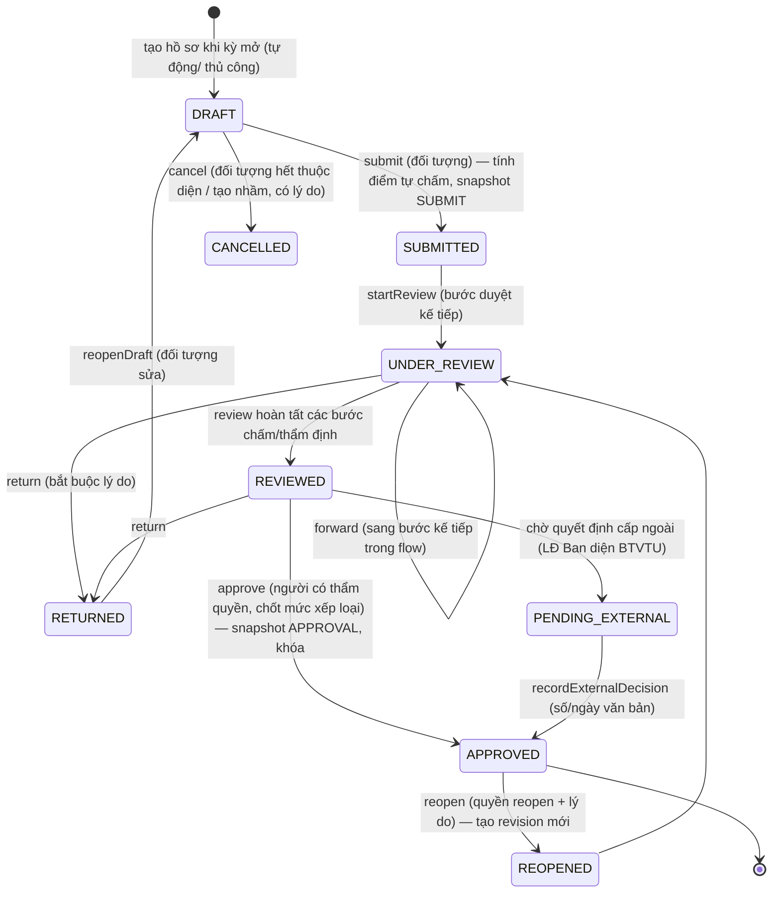
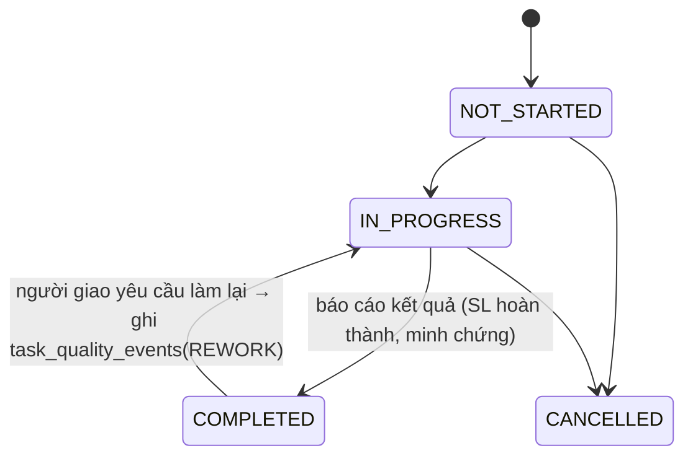
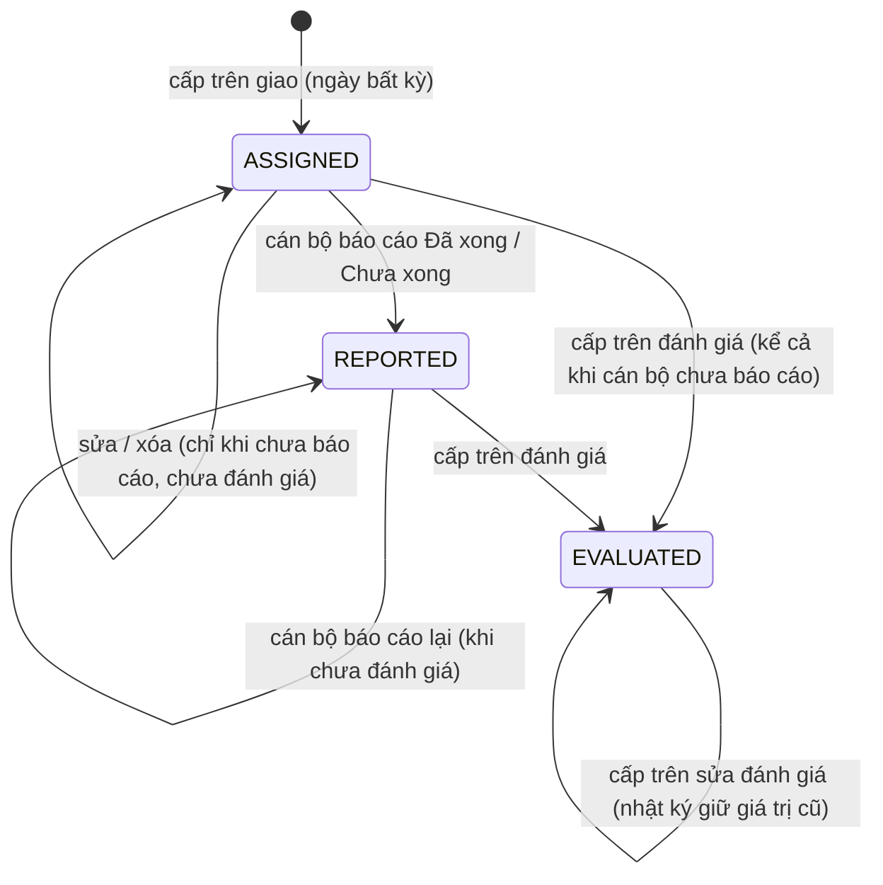

# Quy trình và sơ đồ trạng thái

> Tài liệu thiết kế chuẩn (GĐ1–2, đã duyệt). Mọi thay đổi kiến trúc phải cập nhật tài liệu trước khi sửa code — xem CLAUDE.md.

## 5.1 Hồ sơ đánh giá (`evaluation_records.status`)

**Bất biến:**

- Mỗi chuyển trạng thái chạy trong **một transaction** gồm: kiểm tra `version`, kiểm tra quyền/bước, cập nhật record, ghi `approval_history`, ghi `evaluation_calculations` (nếu có), ghi `audit_logs`, tạo `notifications`.
- Chuyển trạng thái không hợp lệ trả về `409 INVALID_TRANSITION`. Sai quyền trả về `403`.
- Chỉ được nộp khi kỳ ở trạng thái `SELF_ASSESSMENT`, hoặc `REVIEW` nếu hồ sơ bị trả lại.
- `APPROVED` → `REOPENED` sinh `revision_no + 1`. Bản đã duyệt cũ giữ nguyên để tra cứu.

## 5.2 Nhiệm vụ (`tasks.work_status`), tách khỏi phê duyệt

"Quá hạn" và "Sắp đến hạn" là cờ suy ra từ `due_date` và trạng thái; không phải trạng thái lưu. Hoàn thành sau `due_date` sẽ tự tạo `LATE` event, người giao có quyền miễn trừ kèm lý do.

## 5.3 Phiên bản cấu hình

- `rule_set_versions`: DRAFT → PENDING_CONFIRMATION → CONFIRMED → RETIRED.
- `criteria_versions`, `work_catalog_versions`: DRAFT → SUBMITTED → APPROVED → RETIRED.
- Phiên bản đã CONFIRMED/APPROVED là **bất biến**; muốn sửa thì tạo phiên bản mới.
- Kỳ đánh giá **ghim** phiên bản tại thời điểm mở kỳ.

## 5.4 Kỳ đánh giá

PLANNING → OPEN → SELF_ASSESSMENT → REVIEW → CLOSED. Quý IV có `is_rated=false` (theo [QĐ39] Điều 14, [HD05] III.6): vẫn theo dõi kết quả nhưng không xếp loại riêng.

**Ràng buộc theo trạng thái kỳ (triển khai GĐ6):**

| Thao tác hồ sơ                                    | Kỳ phải ở trạng thái                                                              |
| ------------------------------------------------- | --------------------------------------------------------------------------------- |
| Tạo hồ sơ                                         | khác CLOSED (và kỳ có xếp loại)                                                   |
| Tự đánh giá, nộp                                  | OPEN, SELF_ASSESSMENT; hoặc REVIEW nếu hồ sơ đang bị trả lại                      |
| Thẩm định, hoàn tất thẩm định, trả lại, phê duyệt | OPEN, SELF_ASSESSMENT, REVIEW                                                     |
| Mở lại                                            | mọi trạng thái trừ PLANNING (mở lại sau khi đóng kỳ vẫn được — cần quyền + lý do) |

Kỳ PLANNING chỉ để chuẩn bị (tạo hồ sơ, giao nhiệm vụ, chưa chấm). Vi phạm → `422 BUSINESS_RULE`.

**Kỳ tháng (14/10/2026):** cây kỳ của mỗi năm gồm Năm → 6 tháng → Quý → **Tháng**; ngày bắt đầu/kết thúc theo lịch thực tế (tháng 28/29/30/31 ngày, năm nhuận). Hộp "Tạo hồ sơ cho kỳ" cho chọn năm, kỳ **tháng** hoặc **quý**, hiển thị khoảng ngày và đánh dấu kỳ chứa ngày hiện tại. Hồ sơ tháng chỉ tạo được khi có bộ tiêu chí áp dụng cho loại kỳ "Tháng" (cấu hình ở phiên bản bộ tiêu chí — docs/09 #3).

## 5.6 Giao danh sách nhiệm vụ (14/10/2026)

Cấp trên (quyền `task.assign` + nguyên tắc cấp trên, docs/05) lập danh sách nhiệm vụ/sản phẩm cho cán bộ ngay trên hồ sơ đánh giá:

- Chỉ khi hồ sơ ở **DRAFT** hoặc **RETURNED** và kỳ ở PLANNING, OPEN, SELF_ASSESSMENT. Không đổi trạng thái hồ sơ; ghi lịch sử `assignTasks` và nhật ký `evaluation.assign_tasks`.
- Mỗi dòng giao gồm: tên nhiệm vụ, mã sản phẩm trong danh mục (tùy chọn), hệ số, số lượng kế hoạch; lưu vào dữ liệu tự đánh giá của mục KPI tổng hợp với cờ `assigned = true`.
- Cán bộ được đánh giá **không sửa/xóa** được tên, hệ số, số lượng kế hoạch của dòng do cấp trên giao (server giữ nguyên các trường này khi lưu tự đánh giá); cán bộ nhập số lượng hoàn thành, làm lại, chậm, miễn trừ, vượt mức và có thể thêm dòng nhiệm vụ phát sinh của mình.
- Giao lại danh sách: dòng trùng tên + mã danh mục với dòng đã giao giữ nguyên số liệu cán bộ đã nhập; dòng bị bỏ khỏi danh sách giao sẽ bị xóa; dòng cán bộ tự thêm không bị ảnh hưởng.
- Lớp thẩm định không đổi: người thẩm định chấm lại toàn bộ các dòng như trước.

## 5.5 Chuỗi phê duyệt seed (PENDING — cần xác nhận)

| Đối tượng                 | Bước 1           | Bước 2                                                    | Bước 3                                   | Quyết định                                   |
| ------------------------- | ---------------- | --------------------------------------------------------- | ---------------------------------------- | -------------------------------------------- |
| Chuyên viên/nhân viên     | Tự chấm          | DIRECT_MANAGER (Phó/Trưởng phòng) chấm, nhận xét, đề xuất | EVAL_OFFICER thẩm định hồ sơ             | SUPERVISING_LEADER (PTB phụ trách) phê duyệt |
| Phó phòng                 | Tự chấm          | UNIT_HEAD chấm                                            | EVAL_OFFICER thẩm định                   | SUPERVISING_LEADER                           |
| Trưởng phòng / Chánh VP   | Tự chấm          | SUPERVISING_LEADER chấm                                   | EVAL_OFFICER thẩm định                   | HEAD_OF_AGENCY                               |
| Lãnh đạo Ban (diện BTVTU) | Tự chấm          | Tập thể LĐ Ban (HEAD_OF_AGENCY ghi nhận)                  | EVAL_OFFICER lập hồ sơ, tờ trình dự thảo | EXTERNAL_AUTHORITY: ghi số/ngày văn bản      |
| Tập thể phòng             | Trưởng phòng lập | EVAL_OFFICER thẩm định                                    | —                                        | HEAD_OF_AGENCY                               |

## Trạng thái triển khai (GĐ5)

Máy trạng thái thực tế (`apps/api/src/workflow/evaluation-state.ts`, hàm thuần có unit test):

```mermaid
stateDiagram-v2
  [*] --> DRAFT : tạo hồ sơ (period.manage)
  DRAFT --> DRAFT : saveSelf
  DRAFT --> SUBMITTED : submit — đủ dữ liệu, ảnh chụp SELF
  RETURNED --> DRAFT : saveSelf (đối tượng sửa)
  RETURNED --> SUBMITTED : submit
  SUBMITTED --> UNDER_REVIEW : saveReview
  SUBMITTED --> REVIEWED : completeReview — ảnh chụp REVIEW
  UNDER_REVIEW --> REVIEWED : completeReview
  SUBMITTED --> RETURNED : return (lý do)
  UNDER_REVIEW --> RETURNED : return (lý do)
  REVIEWED --> RETURNED : return (lý do)
  REVIEWED --> APPROVED : approve — quy tắc CONFIRMED + bộ tiêu chí APPROVED + kỳ có xếp loại; ảnh chụp APPROVAL; khóa
  APPROVED --> REOPENED : reopen (evaluation.reopen + lý do) — revision + 1
  REOPENED --> UNDER_REVIEW : saveReview
  REOPENED --> REVIEWED : completeReview
```

- Khóa sau phê duyệt được bảo đảm 2 lớp: service trả `409 INVALID_TRANSITION` ("phải thực hiện quy trình mở lại"); trigger DB chặn mọi UPDATE hồ sơ APPROVED (trừ chuyển REOPENED + revision + 1) và mọi ghi `evaluation_items` của hồ sơ APPROVED.
- Không ai thẩm định/phê duyệt/mở lại hồ sơ của chính mình (403). Phê duyệt chọn mức khác mức đề xuất → bắt buộc lý do.
- **Điều chỉnh tạm so với §5.1:** chưa ràng buộc trạng thái kỳ khi nộp (chỉ chặn khi kỳ CLOSED); chưa có chuỗi duyệt nhiều bước (`forward`), bước chờ quyết định cấp ngoài, hủy hồ sơ, thông báo — để GĐ6 cùng approval_flows. Kỳ không xếp loại riêng (Quý IV) không tạo được hồ sơ.
- Bộ quy tắc: DRAFT → PENDING_CONFIRMATION → CONFIRMED → RETIRED; PENDING → DRAFT (trả lại). Bộ tiêu chí: DRAFT → SUBMITTED → APPROVED → RETIRED; SUBMITTED → DRAFT. Danh mục: SUBMITTED → APPROVED. Kỳ: chỉ chuyển sang trạng thái liền kề.

## 5.7 Giao việc và đánh giá hằng ngày (14/10/2026)

Sổ giao việc theo ngày, xem theo tuần (Thứ Hai → Chủ nhật). Cấp trên chọn **ngày bất kỳ** để giao việc cho cấp dưới; cán bộ báo cáo; cấp trên đánh giá từng việc.

- Trạng thái suy ra từ dữ liệu (`report_status`, `result`), không lưu cột riêng.
- **Đánh giá không quy ra điểm:** kết quả (hoàn thành / chưa hoàn thành), chất lượng (đạt yêu cầu / phải làm lại), tiến độ (đúng hạn / chậm) và nhận xét. Các tiêu chí này tương ứng với khái niệm "làm lại", "chậm tiến độ" của [HD05] PL2, nhưng văn bản **không** quy định chấm điểm hay xếp loại theo ngày → hệ thống chỉ tổng hợp số lượng (tuần, tháng) để người đánh giá tham khảo khi chấm hồ sơ tháng/quý (docs/09 #35).
- Báo cáo bị khóa sau khi cấp trên đã đánh giá.
